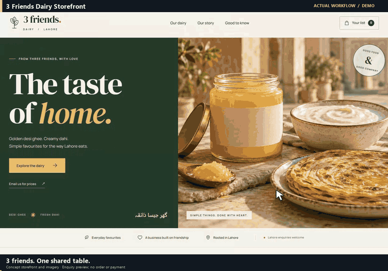

# 3 Friends Dairy Storefront

A responsive static storefront for a Lahore dairy concept. Visitors choose products, sizes and quantities, then prepare an enquiry by copy, download or email draft. Prices, stock and delivery are confirmed outside the site.

Run `python preview.py` and open its printed loopback URL. Only `dist/` is served. Public sample contact is `enquiries@example.com`; replace it before using the storefront for a business.

Product images are AI-generated concept visuals, not photographs of verified production stock. DM Serif Display and Manrope font licenses are included in `dist/assets/`. The demo captures the real staged interface with Playwright: product size selection, the enquiry basket and the prepared message. No order or payment is submitted.

## Demo

The demo records actual local interactions with fictional inputs. Cursor movement, camera zooms and captions are added for readability. See CREDITS.md for the exact recording setup.

## Source references

See [Credits and source references](CREDITS.md) for the upstream tools, libraries and fonts used, and details of the workflow recording.

[Download the full-motion recording](docs/demo.mp4).

[Try the demo and a practical exercise](docs/QUICKSTART.md).
